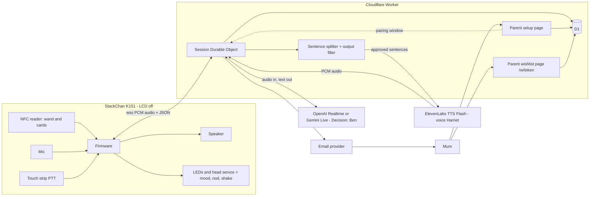
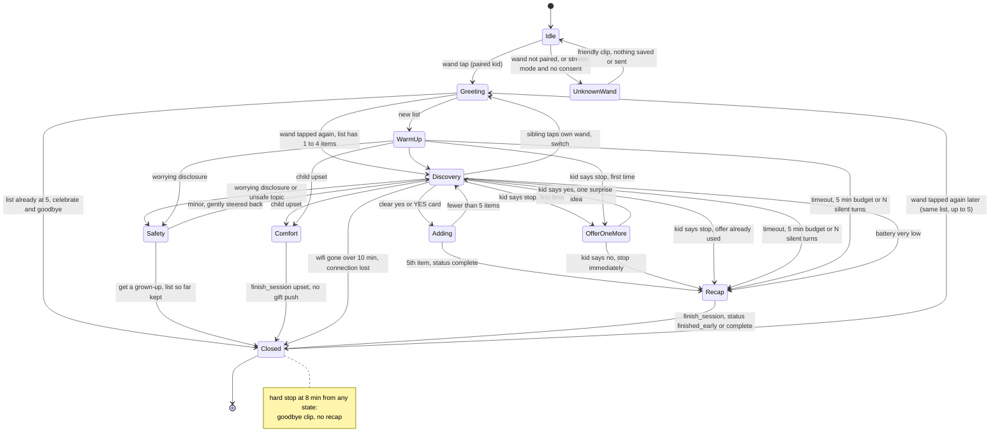

> **Status:** proposed design for Day 11 ("Wish"). **The character name "Aunty Bella" is provisional.** Written 16 Nov 2026 and updated the same day for the voice, LCD-off, wand, parent-setup, early-finish and edge-case (D9) decisions. Nothing here is built or tested. It follows what the team already decided in [Day 11 - Brief & prep](https://app.superthread.com/40for40/page-60-day-11-brief--prep) (MVP, StackChan + Cloudflare Worker + speech/voice models, RFID as auth) and the research in cards [303](https://app.superthread.com/40for40/card-303-research-jakcom-n3-nail-chip) (N3 chip) and [304](https://app.superthread.com/40for40/card-304-research-stackchan-with-the-n3-nail-and-a-voice-agent) (StackChan + voice agent). Prompt, tools and parent FAQ: [Day 11 – Agent Prompt & Harness](https://app.superthread.com/40for40/page-61-day-11--agent-prompt--harness). Repo: https://github.com/build40for40/day11

## 0. Decisions since the first draft (16 Nov 2026)

| # | Decision | Effect |
|---|---|---|
| D1 | **Aunty Bella's voice is ElevenLabs "Harriet- Mature British Actress"**, `voice_id = aAsWcN5jdLdiYG7Hq0YL` (professional library voice, British accent; mature, educated, warm and clear). The character is Aunty Bella. | Voice output goes through ElevenLabs. Two ways to do it: section 3.3. **Recommended: Option B.** |
| D2 | **StackChan's LCD face is OFF.** Aunty Bella expresses herself with LEDs and head movement only. | `set_face` replaced by `set_mood` (LED pattern + head move). No face drawing in firmware. |
| D3 | **OpenAI vs Gemini: undecided. Decision: Ben.** | The `Upstream` (language model) adapter stays. Harriet is the voice either way. |
| D4 | **Parent setup captures Mum's email** and links the kid's wand UID to it. | New setup flow, D1 tables, endpoints and messages. Sections 4, 6.4 and 7. |
| D5 | **Wand, not nail.** | Today's wand is a marker with an RFID chip taped on (page 57). The N3 research (card 303) still applies to the chip. |
| D6 | The recovered prompt wording is OK. | Only the changes forced by D1-D5 and D7 were made to the prompt. |
| D7 | **The character is renamed from "Pip the Elf" to "Aunty Bella" (voiced by Harriet). The name is provisional.** She is a kindly aunt figure from the North Pole who works with Santa, not an elf. | Prompt, dialogue and diagrams renamed. Rules, tools, 5-cap, LEDs, head movement and the parent flow are unchanged. |
| D8 | **Early finish: the kid is in charge.** On "that's enough", "I'm done" or wandering off, Aunty Bella offers at most ONE "one more surprise idea?" and stops at once on no. A list of 1 to 4 items is a valid result: happy recap, still sent to Mum, marked "finished early" with a short reason. Tapping the wand again later continues the same list up to 5. The Worker wraps up after N silent turns or the 5-minute budget, using a new `finish_session(reason)` tool. | New tool, SYSTEM lines, timers, session state, D1 columns, sequences 4.2 to 4.3, state graph 4.4. Harness page: prompt, dialogue and FAQ. |
| D9 | **Edge cases get explicit handling.** Kid behaviour (yes to everything, changing their mind, big or impossible asks, screen or brand asks, "are you real / is Santa real", upset), several children, tech problems, parent and data cases, safety cases. New tool `remove_from_wishlist`; more `finish_session` reasons. Big, screen and brand asks get a gentle redirect in conversation only, nothing goes to Mum. Worrying disclosures: `finish_session(safety)` plus a Worker-side flag that emails Mum only a short neutral note. **Decided by the user on 16 Nov:** (1) sibling wand tap switches the chat; (2) unknown wand = pre-recorded clip only; (3) the "are you real / is Santa real" lines are OK; (4) no tool for passing asks to Mum (rejected); (5) worrying notes go to Mum only. | Section 4.5 (Worker and device handling), the state graph, device messages, D1 schema (`item_norm`, `safety_flags`, approvals) and the parent page. |

## 1. Summary of key decisions

| # | Decision | Why |
|---|---|---|
| 1 | **StackChan K151 is the body**; a **Cloudflare Worker is the brain**. | Card 304. The K151 has a built-in NFC reader (ST25R3916), mic, speaker, servos, 12 LEDs. |
| 2 | **Identify the kid by wand UID, not NDEF.** | Card 304: UID is the most reliable read. Card 303: the N3 is very likely an NTAG213 with a 7-byte UID (unconfirmed). RFID doubles as auth; siblings get separate lists (page 60). |
| 3 | **Voice = ElevenLabs Harriet, via Option B (recommended):** the language model replies with text, the Worker checks each sentence, then ElevenLabs streaming TTS (Flash model) speaks it. Option A (ElevenLabs Conversational AI agent) is the documented alternative and fallback. | Option B lets the output filter check text **before** it is spoken, which closes the "partly enforceable" gap. Trade-off: extra latency and more to build. Section 3.3. |
| 4 | **Language model: OpenAI Realtime or Gemini Live in text-out mode. Decision: Ben.** | Both can take audio in and give text out. Kept behind the `Upstream` adapter. |
| 5 | **Push to talk** on the head touch strip. | Card 304: stops the robot hearing itself and cutting itself off. Also a privacy feature: the mic is only open while held, and a steady green LED ring shows it. |
| 6 | **One Durable Object per chat session** holds the device socket, the upstream sockets, the session state and the 5-item cap. | A plain Worker request can't hold several long-lived sockets and state. A DO can. |
| 7 | **D1 for households, kids, cards, wishlists and a small session log** (card 304: "the kids, toys and wishlists live in this repo's own D1"). KV is not needed. | Relational and tiny. DO storage holds only in-flight session state. |
| 8 | **Hard cap of 5 and all safety checks live in the Worker**, never only in the prompt. | Prompt rules can drift. |
| 9 | **LCD off; LEDs + head movement only.** | Screen-free brief. The touch strip stays as the input. |
| 10 | **Parent setup before first use:** parent enters email and child's first name on a setup page, then taps the wand on the robot to link it. | Gives "send to Mum" a destination and stops unknown wands starting chats. |
| 11 | **Wishlist is a private web page** at an unguessable parent link (not the UID). Send-to-Mum = email that link to the address from setup. | Keeps the kid's UID out of URLs. |
| 12 | **Fallback is a phone hidden behind StackChan** if the mic/speaker/round-trip proofs fail. | Card 304. The Worker is unchanged; only the client changes. |
| 13 | **No audio saved, no transcripts by default.** | Child's voice data. See the FAQ on the Harness page. |
| 14 | **The kid decides when they are finished (D8).** One list per kid, with a status: `empty`, `in_progress`, `finished_early`, `complete`. A session is one chat; many sessions can add to the same list until it holds 5. | Short chats suit 3 to 7 year olds, and a wand tap must never throw away or restart a list. |
| 15 | **Edge cases are handled in the Worker and device, not only in the prompt (D9).** Mishearing confirms, merges duplicates, raises a safety flag every time, sanitises names, stream mode, battery and wifi rules live in code. | The prompt can drift; code cannot be talked round by an older sibling. Section 4.5. |

## 2. System overview

Recommended design (Option B). The ElevenLabs agent route (Option A) is in section 3.3.

```text
+-------------------------------+        wss (audio + JSON)         +-------------------------------------------+
|  StackChan K151 (device)      | <--------------------------------> |  Cloudflare Worker  "wish"                |
|                               |                                    |                                           |
|  NFC reader  -> wand / card   |                                    |  fetch handler: routes, auth              |
|                 UID events    |                                    |    /ws        -> Session DO               |
|  Mic (I2S)   -> PCM16 16kHz   |                                    |    /setup/*   -> parent setup page        |
|  Speaker     <- PCM16 24kHz   |                                    |    /w/:token  -> parent wishlist page     |
|  Servos      <- nod / shake / |                                    |    /admin/*   -> create household, cards  |
|                 mood head move|                                    |                                           |
|  12 RGB LEDs <- colour / mood |                                    |  Session Durable Object (1 per chat)      |
|  Touch strip -> push-to-talk  |                                    |    device socket <-> LLM socket + TTS     |
|  microSD     -> offline clips |                                    |    sentence splitter, OUTPUT FILTER       |
|  LCD: OFF (backlight off)     |                                    |    tool handler, cap=5, timers, pairing   |
+-------------------------------+                                    +---+-------------+-------------+-----------+-+
                                                                         |             |             |           |
                                          audio in, TEXT out (wss)       |   text (wss)|        D1   |     email |
                                                                         v             v             v           v
                                                       +---------------------+  +-----------------+ +-------+ +--------------+
                                                       | OpenAI Realtime  or |  | ElevenLabs TTS  | | D1    | | Email        |
                                                       | Gemini Live         |  | Flash model     | | (see  | | provider     |
                                                       | Decision: Ben       |  | voice Harriet   | |  6.4) | | (setup,      |
                                                       | tools + text reply  |  | aAsWcN5jdLdiYG7 | |       | |  verify,     |
                                                       +---------------------+  | Hq0YL -> PCM    | +-------+ |  link)       |
                                                                                +-----------------+           +--------------+

   Mum's phone ---- https /setup/:setupToken (one-off: email, kid name, tap the wand) ----> Worker
   Mum's phone ---- https /w/:parentToken   (wishlist: remove / reset / delete)        ----> Worker
```

Option B voice path in one line: `kid audio -> LLM (text out) -> sentence splitter -> output filter -> ElevenLabs TTS (Harriet) -> PCM 24 kHz -> Worker -> device speaker`.

The same picture as Mermaid, for a renderer that supports it:



## 3. Components

### 3.1 StackChan device firmware

One Arduino (or PlatformIO) sketch on the K151, four jobs (from card 304):

1. **Mic -> WebSocket.** While the touch strip is held, stream 16 kHz mono PCM16 in ~40 ms binary frames.
2. **WebSocket -> speaker.** Play 24 kHz mono PCM16 from a ring buffer (about 500 ms). ElevenLabs can return raw PCM (`pcm_24000`), which avoids the WAV-only playback gotcha in card 304.
3. **NFC.** Poll the reader (M5Unit-NFC / `M5UnitUnified`, NTAG213 supported per card 304). On a new tag, send `{t:"nfc", uid}`. The wand sits on top of the head; expect near-contact reads. Debounce: ignore the same UID for 2 s.
4. **Commands.** Act on `set_mood`, `nod`, `shake`, `set_leds`.

Other behaviour:
- **LCD off.** Turn the display and backlight off at boot and never draw anything (check the exact M5Unified call on the day). The touch strip on the body is still used as the input. No face is drawn.
- **Mood = LEDs + head move** (table in 3.1.1). Everything the robot "feels" is shown this way.
- **Motion:** `Motion.move(x, y)` with units of 10 = 1 degree. Keep tilt between 5 and 85 degrees or the servo can stall (card 304). `nod` = small tilt down/up; `shake` = small pan left/right. Clamp in firmware, never trust the Worker.
- **Status LEDs** (replace the old sleepy face): connecting = slow white pulse; ready = dim warm-gold breathing; listening (strip held) = steady green ring; offline = "sleepy" (slow dim blue-white breathing, head slightly lowered, no red, so it does not look like an alarm to a child); battery low (20% or less, unplugged) = a slow amber blink every 30 s with a small head dip; grown-up needed (list held, email not confirmed) = slow gold pulse; pairing mode = slow blue pulse. A steady green ring while the mic is open is also the parent-visible mic indicator.
- **Camera:** never initialised.
- **Offline clips:** a handful of WAVs on the microSD, generated once in the Harriet voice (greeting fallback, "can't reach the North Pole", "ask a grown-up to set me up", apology, goodbye, "all paired").
- **More offline clips (D9)**, same voice: `friendly_unknown` ("Hello! I don't know this wand yet. Ask a grown-up to set me up, and then we can chat about Christmas!"), `not_today` (stream mode, household not consented), `plug_me_in`, `sleepy` (reconnecting), `check_setup` ("Ask a grown-up to check the setup page.").
- **Battery:** report `battery` and `charging` in every `ping` (about every 20 s). Firmware shows the low-battery blink and plays `plug_me_in` only between turns, never over speech.
- **Power/wifi:** USB-C power while live. 2.4 GHz wifi only. Credentials in a `secrets.h` that is not committed.
- **Flashing wipes the factory XiaoZhi agent** and it is unclear how easily it comes back (card 304). Decide before flashing; keep a second unit or a phone fallback.

#### 3.1.1 Mood mapping (starting point, tune on the day)

| mood | LEDs | Head | Used for |
|---|---|---|---|
| `happy` | soft gold glow, steady | one small nod | greeting, warm reply |
| `thinking` | slow pulse, white-blue | small tilt to one side, slow sway | picking the next idea, after a "no" |
| `surprised` | quick white flash then gold | quick small tilt up | surprising answer |
| `excited` | gold sparkle chase | double nod | a yes, the first greeting |
| `listening` | steady soft green ring | head level, tiny tilt toward the child | strip held (set by the robot) |

Risk: head and light cues are less expressive than a face. Test with a child-aged viewer early. See risks.

### 3.2 Cloudflare Worker ("wish")

- **fetch handler:** routing and auth. `GET /ws` (device WebSocket upgrade) is forwarded to a Session DO. `/setup/*` is the one-off parent setup. `/w/*` serves the parent wishlist. `/admin/*` creates households and cards. `GET /healthz`.
- **Session Durable Object** (id = `deviceId`; one active chat per device):
  - accepts the device WebSocket (hibernation API is optional; sessions are short);
  - on a **kid wand tap**: loads the kid and their current list from D1 (the kid must be `active`, i.e. paired; if the list has 1 to 4 items the session continues that list, with a SYSTEM line telling the model what is on it), opens the LLM socket (and, for Option B, the ElevenLabs TTS socket), sends the system prompt, the tool list and the audio format;
  - **pairing mode:** if the parent setup page has opened a pairing window for this device (10 minutes), the next wand UID is bound to the pending kid instead of starting a chat (section 4);
  - **audio in:** forwards device PCM to the LLM (resampling 16 kHz to 24 kHz for OpenAI by linear interpolation);
  - **turns:** PTT down/up maps to `input_audio_buffer.commit` + `response.create` with server VAD turned off;
  - **text out (Option B):** reads text deltas, splits into sentences, runs each sentence through the output filter, sends approved sentences to ElevenLabs TTS, forwards the returned PCM to the device;
  - **tool calls:** `add_to_wishlist` is executed in the DO (cap, dedupe, filter, D1 write, `SYSTEM:` injection). `finish_session(reason)` is also executed in the DO: it marks the session as ending, waits for the goodbye audio to finish, writes the end state (below) and sends the device `{t:"end"}`. `set_mood` / `nod` / `shake` / `set_leds` are validated against the enums and forwarded to the device as `cmd` messages. Each tool call returns a small result to the model;
  - **NFC event injection** as `SYSTEM:` messages (see the Harness page, section 3);
  - **Edge-case handling (D9)** (section 4.5): unknown wand, stream mode, sibling switch, mishearing guard, duplicate merge, safety flags, name sanitising, battery and connection rules. `remove_from_wishlist` runs in the DO like `add_to_wishlist`;
  - **timers and wrap-up rules (starting values, tune on the day):**
    - **Silent turns:** a turn is "silent" when the child does not hold PTT within 30 s of Aunty Bella finishing. After the 1st silent turn the DO injects the nudge line. After **N = 2** silent turns it injects the "gone quiet again" line and ends with `finish_session("silence")`. Any child speech resets the count.
    - **5-minute budget:** 5 minutes from the first greeting of this session. At the limit the DO lets the current sentence finish, injects the "Time is up" line and ends with `finish_session("time_budget")`.
    - **Hard stop at 8 minutes:** last backstop, plays the `goodbye` clip, no recap, ends with `hard_stop`.
    - If the model has not called `finish_session` about 15 s after the recap, the DO ends the session itself with the same reason.
    - After any finish reason, further tool calls are ignored except `finish_session`.
  - **session state** (in memory + DO storage for reconnects): `kid_id`, `wishlist[]`, `items_added`, `last_suggestion`, preference flags, `last_seen`, `started_at`, `silent_turns`, `stop_offered`, `ending` (reason, once set), `list_status`;
  - **on end** (same path for every reason): writes the `sessions` row, then sets the kid's list state: 5 items -> `complete` (note "Complete"); 1 to 4 items -> `finished_early` with a short parent-facing note built by the Worker from facts, never by the model (`kid_done`: "Happy with 2"; `silence`: "Chat ended after 3 min (went quiet)"; `time_budget`: "Chat ended after 5 min"; `upset` and `safety`: "Chat ended early: your child needed a grown-up"; `low_battery`: "Chat ended early (robot battery low)"; `connection_lost`: "Chat ended early (connection lost)"; `superseded`: "Chat ended early (a sibling took a turn)"; `hard_stop` and `error`: "Chat ended early (technical)"); 0 items -> list stays `empty` and no email is sent. A later session that adds items updates the same list, the status and the note.
  - **email to Mum:** at the end of the first session that leaves at least 1 item on the list, and again only if a later session makes the list `complete`. Items added in between just appear on the page. Only to a verified or demo-approved address. Then closes all sockets.
- **Parent setup and wishlist pages:** server-rendered HTML, no JS needed except a status poll on the setup page. Section 6.4.
- **Secrets (Worker secrets, never in the repo; `.dev.vars` is already git-ignored):** `OPENAI_API_KEY` or `GEMINI_API_KEY` (Decision: Ben), `ELEVENLABS_API_KEY`, `ELEVENLABS_VOICE_ID` (Harriet: `aAsWcN5jdLdiYG7Hq0YL`), `ELEVENLABS_AGENT_ID` (Option A only), `DEVICE_TOKEN`, `ADMIN_TOKEN`, `UID_SALT`, `EMAIL_API_KEY`.

### 3.3 Voice output through ElevenLabs: Option A vs Option B

Voice: ElevenLabs "Harriet- Mature British Actress", `voice_id = aAsWcN5jdLdiYG7Hq0YL`. Everything below is the same voice. All API details are from the ElevenLabs docs read on 16 Nov 2026 and must be re-checked while building.

#### Option A: ElevenLabs Conversational AI (Agents) runs the conversation

```text
StackChan <-> Worker/Session DO <-> ElevenLabs agent (wss, signed URL)
                                       agent LLM + turn-taking + TTS in voice Harriet
```

- **Setup:** create an agent in ElevenLabs with `voice_id = aAsWcN5jdLdiYG7Hq0YL`, the Aunty Bella system prompt, and the LLM chosen in the agent settings (this is where OpenAI vs Gemini would be picked, Decision: Ben). Define **client tools** with the same names and schemas as the tool JSON: `add_to_wishlist`, `set_mood`, `nod`, `shake`, `set_leds`.
- **Worker brokers a signed URL:** the Worker calls the ElevenLabs "get signed URL" endpoint with the agent id and API key (`GET /v1/convai/conversation/get-signed-url?agent_id=...`) and opens the returned `signed_url` WebSocket. The API key never reaches the device.
- **Why the Worker stays in the middle:** the Session DO relays the socket between StackChan and the agent, so it can intercept tool calls. The device connects only to the Worker (the contract in section 7.1 is unchanged).
- **Per-session config:** on connect, the DO sends `conversation_initiation_client_data` with `dynamic_variables` (kid first name, item count) and, if enabled in the agent's security settings, a `conversation_config_override` for prompt, first message and `voice_id`.
- **Audio:** device PCM -> DO -> `user_audio_chunk` (base64). Agent audio events (base64) -> DO -> device. Agent output format must be set to PCM so the device can play it.
- **Tool calls:** the agent sends a client-tool request (`client_tool_call` with `tool_name`, `tool_call_id`, `parameters`). The DO handles it: `add_to_wishlist` runs in the Worker (**cap of 5, dedupe, filter, D1 write**) and the DO answers with `client_tool_result` (`tool_call_id`, `result`, `is_error`); the other four are forwarded to StackChan as `cmd` messages. **The cap is still enforced in the Worker**, never in the agent config.
- **SYSTEM events** (card taps, "wishlist now has 3 items") are sent as non-interrupting contextual updates.
- **Variant A2 (not recommended):** let the device connect straight to ElevenLabs with the signed URL. Then `add_to_wishlist` would have to be a webhook (server) tool calling our Worker so the cap still lives in the Worker, and the Worker no longer sees the conversation. Loses interception and logging.
- **Push to talk:** the agent runs its own voice-activity detection. We only stream audio while the strip is held, and a gap ends the turn. There is no explicit "commit" like OpenAI's; test that end-of-turn feels right.
- **Agent prompt lives in ElevenLabs** (or is overridden at session start), so it can drift from `prompts/aunty-bella.system.md` in the repo.

#### Option B: language model in text-out mode feeding ElevenLabs streaming TTS (Flash model)

```text
kid audio -> OpenAI Realtime / Gemini Live (audio in, TEXT out) -> Session DO
          -> sentence splitter -> OUTPUT FILTER -> ElevenLabs TTS WebSocket (Flash, voice Harriet)
          -> PCM 24 kHz -> Session DO -> StackChan speaker
```

- **LLM:** OpenAI Realtime with the response modality set to text, or Gemini Live with a TEXT response modality (**check the chosen Gemini Live model supports text output; some native-audio models only answer in audio, which would rule out B for that model**). Audio goes in, text and tool calls come out. Decision: Ben.
- **Sentence splitter:** accumulate text deltas, cut at sentence ends (`. ! ?`) or after ~25 words, so each unit is short enough to check and speak quickly.
- **Output filter on text, before speech:** each sentence is checked **before** it is sent to ElevenLabs. If it fails: nothing is spoken, the DO cancels the response (`response.cancel`), plays a canned in-voice line ("Oops, let's try something else") and re-prompts. This is the fix for the earlier "spoken output filter: partly enforceable" gap (section 3.4).
- **ElevenLabs TTS WebSocket:** `wss://api.elevenlabs.io/v1/text-to-speech/aAsWcN5jdLdiYG7Hq0YL/stream-input?model_id=eleven_flash_v2_5&output_format=pcm_24000`, authenticated with the `xi-api-key` header from the Worker. First message sets `voice_settings` (start: stability 0.5, similarity_boost 0.8, speed slightly under 1 for young children); then approved sentences are sent as text, with a flush at the end of each turn. The docs recommend `auto_mode` when sending whole sentences, which lowers latency. Audio chunks come back base64-encoded and go straight to the device. Per the docs, 44.1 kHz PCM needs a Pro plan, so use 24 kHz. Check the exact message fields (flush, end-of-input) in the current docs.
- **Interruption:** PTT down while Aunty Bella is speaking -> `audio_cancel` to the device, close or flush the TTS socket, `response.cancel` to the LLM.
- **Tool calls:** unchanged from the earlier design (function calls from the LLM, handled in the DO).
- **Prompt stays in the repo** and is the only copy.
- **Audio privacy:** the kid's voice goes only to the LLM provider. ElevenLabs sees only text.
- **Model names:** `eleven_flash_v2_5` is the Flash model id at the time of writing; verify. ElevenLabs quotes roughly 75 ms for Flash inference; that excludes network and our hops. Unmeasured by us.

#### Recommendation: Option B

| | Option A (ElevenLabs agent) | Option B (LLM text-out + ElevenLabs TTS) |
|---|---|---|
| Speech output check | After the fact (text arrives with or after audio; the platform has its own guardrails feature, scope unverified) | **Before speech.** Every sentence is checked first. Fully enforceable for what is spoken |
| Latency | Fewer hops, platform-tuned turn-taking and streaming. Likely the faster of the two | One extra hop and a sentence buffer: first audio waits for the first full sentence + filter + TTS first byte. Likely roughly 0.3-1 s slower than A (unmeasured) |
| Build effort today | Less: configure an agent, relay a socket, map tool calls | More: splitter, TTS socket, flush and cancel handling. Contained in one adapter |
| Vendors that hear the child | ElevenLabs (audio) + the agent's LLM | LLM provider only (audio). ElevenLabs gets text only |
| Prompt and config | Lives partly in the ElevenLabs dashboard | One copy, in the repo |
| OpenAI vs Gemini | Chosen in the agent's LLM setting | Chosen in the `Upstream` adapter. Gemini needs a text-capable Live model |
| Cap of 5 | In the Worker via client-tool interception | In the Worker (same) |
| Turn-taking / PTT | Platform VAD; PTT is approximate | Our own PTT commit, exact |
| Barge-in | Built in | We implement it |
| Fallback value | Good plan B if B's latency is too high | - |

**Recommended: Option B**, because the safety checks are what parents care about most, and B is the only option where "never spoken unless approved" is true. Prompt and tools stay in the repo, and B keeps the kid's voice away from a third vendor. The cost is latency and build time, so there is a **gate**: at the first end-to-end test (target 14:15 UK), measure time from the end of the child's turn to the first sound. If it is still over about 2.5 s after tuning (sentence splitting, `auto_mode`, shorter sentences, a short filler line such as "Hmm, let me think!" in Harriet's voice), switch to Option A. The tool schemas, device contract and Worker state are the same either way, so the switch is one adapter.

### 3.4 Safety layer in the Worker

| Control | Enforceable? | How |
|---|---|---|
| Hard cap of 5 items | Yes | `add_to_wishlist` returns an error result when `count >= 5`; the DO ignores any further add. The cap is a constant in the Worker, not in the prompt (both options). |
| Item and reason filter | Yes | Before saving, check length (<= 80 / 160 chars), strip anything that looks like a URL, price (pound or dollar signs, "pounds"), phone number or email, and run a small denylist (violence, adult, brand list). Reject with a tool error so Aunty Bella tries again. |
| "Only after a clear yes" | Partly | Prompt rule, plus a guard: no add unless a child turn (PTT) or a YES card arrived since the previous add. Cannot truly verify intent. |
| Dedupe | Yes | Same normalised item twice is ignored. |
| **Spoken output filter** | **Yes in Option B (changed from "partly"); partly in Option A** | Option B: every sentence is checked before it reaches ElevenLabs, so nothing unchecked is spoken. The check is still only as good as its rules: start with a denylist (violence, adult, brands, prices, personal-data patterns) and optionally a moderation call per sentence (adds latency). Test with adversarial prompts. Option A: only react-after-start (cancel on a transcript hit; a few hundred ms may already have played). |
| Worrying content | Partly | Prompt rule. The DO keyword-flags ("hurt", "scared", "alone", etc.) into the session log with a `flags` column and raises the Worker-side safety flag (below). Not a safeguarding system. |
| Personal data | Partly | Prompt says first name only. Transcripts are not stored by default, so nothing to leak at rest. |
| Mishearing guard | Partly | `add_to_wishlist` for a kid-originated item needs a confirm turn: the DO tracks `pending_confirm` and rejects the add unless a child turn (PTT) or YES card arrived after the repeat-back. Cannot verify the child really said yes. |
| Duplicates across sessions | Yes | `item_norm` unique per kid among non-removed items; a repeat merges (reasons combined) and returns `ok, merged`. |
| Safety flag (worrying disclosure) | Partly | The Worker raises a flag **every time** `finish_session(safety)` is called or a keyword matches the transient transcript: one `safety_flags` row (no content, no transcript) and an immediate email to the parent only, with a fixed neutral note ("Something your child said may need a grown-up check-in, so Aunty Bella ended the chat."). No banner, no tool the model can use to write free text to Mum. Not a safeguarding system. |
| Name sanitising | Yes | `first_name` is letters, spaces and hyphens only, up to 20 characters, checked on the setup form and again before it goes into the prompt, so a name cannot carry instructions. |
| Stream mode | Yes | `STREAM_MODE=true` lets only households with `stream_consent_at` start chats; others get `not_today`. Does not control the camera. |
| Prompt injection by older siblings | Partly | Rules are in the system prompt; the cap, tool-argument validation, spoken-text filter, name sanitising and card labels (set by an adult) are code. Red-team scenarios on the Prompt Testing page. |
| Early finish is the kid's choice | Partly | The Worker never tries to keep a chat going: its timers can only end a chat sooner. "At most one offer, then stop" is a prompt rule; backstop: count spoken sentences that look like an offer ("one more") and drop a second, injecting `SYSTEM: You have already offered ... Do the recap now.` Test with a child who says stop twice. |
| Wrap-up after silence or time | Yes | Silent-turn counter, 5-minute budget and 8-minute hard stop live in the DO, not the prompt. |
| One list per kid, continued by a wand tap | Yes | The list and its status are in D1, not session memory. A tap never creates a second list or clears items; only the parent can reset it. |
| Unknown wand | Yes | A UID that is not paired to a kid never starts a chat. |

### 3.5 Storage

See the schema in section 6.4. Durable Object storage holds only in-flight state (session state and the pairing window), with a 10-minute reconnect window, cleared at session end. KV is not used.

## 4. Sequences

### 4.1 One-off parent setup (new): email, kid name, link the wand

```text
Mum (phone)         Worker (setup page + D1)          Session DO (device)        StackChan        Email
 |                           |                              |                        |              |
 | open setup link --------> |  (link made by /admin/households, one-time token)      |              |
 | <------ form: email, kid first name(s), "device" ------   |                        |              |
 | submit email + "Lily" --> | create household (email, not yet verified)      |              |
 |                           | create kid(status=pending, no uid yet)                 |              |
 |                           | open pairing window: device, kid, expires in 10 min --> |              |
 |                           | send "confirm your email" link ---------------------------------> | Mum
 | <- page: "Tap Lily's wand on Aunty Bella now" (polls /status) |                        |              |
 |                           |                              | LEDs: slow blue pulse ->  (pairing mode)
 | tap wand on robot ----------------------------------------------------------> {nfc, uid} ----> |
 |                           |      <--------------- {nfc, uid} ------------------|              |
 |                           | uid not already paired? bind uid_hash to pending kid, status=active
 |                           |                              | <- {t:"paired", name} ---------> LEDs gold, nod, "all paired" clip
 | <- page: "Lily's wand is linked"                         |                        |              |
 | click confirm link in email -> /verify/:token  -> households.email_verified_at set  |              |
 | (repeat the wand tap step for each child)                |                        |              |
```

Rules:
- A pairing window is tied to one device and one pending kid, lasts 10 minutes, and is single-use.
- A UID that is already paired to another kid is rejected ("this wand is already linked") unless a parent deletes that kid first.
- Email verification can be skipped for the demo by an admin flag; real use should verify before sending list links.
- The wand UID is never shown to anyone. Only its salted hash is stored.

### 4.2 Chat: tap, greet, discover, add, recap, send to Mum (Option B shown)

```text
Kid     StackChan           Worker / Session DO              D1        LLM (text out)   ElevenLabs TTS      Mum
 |          |                       |                        |             |                  |               |
 | tap wand>|                       |                        |             |                  |               |
 |          | {nfc, uid} ---------> |                        |             |                  |               |
 |          |                       | kid by uid_hash, active? -------->   |                  |               |
 |          |                       | <---------------------- kid {name}   |                  |               |
 |          |                       | open LLM + TTS sockets, send prompt, tools, wand-tap SYSTEM line ---------->  |
 |          | <-- {session, kid} -- |                        |             |                  |               |
 |          | <-- cmd set_mood=excited, set_leds=gold, nod <----------- tool calls            |               |
 |          |                       | <---------- text "Oh! Hello! I'm Aunty Bella..." ------|               |
 |          |                       | sentence 1 -> OUTPUT FILTER (pass) -> text --------------------------->  |
 |          | <-- PCM audio (Harriet) <------------------------------------------ audio -------|               |
 | hold the |                       |                        |             |                  |               |
 | strip:   | {ptt:down}+PCM -----> | append audio ------------------------> |                  |               |
 | "I like  |                       |                        |             |                  |               |
 |  blocks" | {ptt:up} -----------> | commit + response.create ---------->  |                  |               |
 |          | <-- cmd set_mood=thinking (while waiting)       |             |                  |               |
 |          |                       | <---- text "Blocks are brilliant. Would you like wooden blocks?"              |
 |          |                       | each sentence: FILTER -> TTS ----------------------------------------> |
 |          | <-- PCM audio (Harriet) <-------------------------------------------- audio -----|               |
 | hold:    |                       |                        |             |                  |               |
 | "yes!"   | PCM, ptt:up --------> | ---------------------------------> |                  |               |
 |          |                       | <------- tool: add_to_wishlist(item, reason)          |               |
 |          |                       | cap, dedupe, filter, insert ---->   |             |                  |               |
 |          |                       | tool result ok(count=1) ---------->  |             |                  |               |
 |          |                       | SYSTEM: Wishlist now has 1 item. Aim for 5. ------>  |                  |               |
 |          | <-- cmd set_mood=excited, set_leds=gold, nod <--- tool calls |                  |               |
 |          | <-- PCM "That's one!..." (Harriet) <----------- filtered text -> TTS               |               |
 |   ... discovery loop repeats; card taps arrive as {nfc, uid} -> SYSTEM: tapped YES card ...                  |
 |          |                       | 5th add: SYSTEM: 5 items. Do the happy recap. ----> |                  |               |
 |          | <-- cmd set_leds=rainbow, set_mood=happy, PCM recap (Harriet)    |                  |               |
 |          | <-- {end, reason: complete} (after recap audio finishes)        |                  |               |
 |          |                       | write sessions row, close sockets                      |               |
 |          |                       | email parent link (to the email from setup) --------------------------> |
 |          |                       |                        |             |                  |  opens /w/:token
```

If Option A is used instead, the LLM and TTS columns collapse into one "ElevenLabs agent" column. Tool calls arrive as client-tool requests that the DO answers. Spoken audio comes back from the agent with no filter step in between.

Variants:
- **Unknown or unpaired wand UID:** Worker replies `{t:"session", kid:null, mode:"unregistered"}`; the device plays the `friendly_unknown` clip with a gold glow and a nod and opens **no microphone and no upstream** (nothing is sent, nothing saved). The Worker never creates kids from taps. **Decided (user, 16 Nov): clip only, no live chat.**
- **Second tap of the same wand mid-chat:** ignored (debounce).
- **A different kid's wand mid-chat (decided: switch):** the current session ends as `superseded` (items kept, first kid's list `finished_early`, note "Chat ended early (a sibling took a turn)") and a new session starts for the tapped wand with a greeting.
- **Silent turns:** after 30 s with no PTT Aunty Bella nudges once ("Are you still there?"). After the 2nd silent turn she does a short recap and says goodbye, and the Worker ends the session with `silence` (section 4.3).
- **Wand tapped again later with 1 to 4 items on the list:** the session continues the same list: SYSTEM line with the items so far, `count` in the `session` message, no new list. When it reaches 5 it becomes `complete`.
- **List already at 5 for this kid:** Aunty Bella is told so up front ("The list is full. Celebrate it and say goodbye. A new list starts only if the parent resets it"). No new list is created by a tap.
- **Kid says stop or wanders off:** early finish (section 4.3).

### 4.3 Early finish and timeouts (D8)

Three ways a chat can end before 5 items. All use the same ending path.

```text
Kid says "that's enough"            Session DO                     LLM            Mum
 |                                     |                            |              |
 | "I'm done" (PTT) ----------------> | audio -----------------> |              |
 |                                     | <-- text: "Would you like one more surprise idea?" (the ONE offer)
 |                                     | stop_offered = true (filter saw the offer sentence)
 | "No." (PTT) ---------------------> | ----------------------> |              |
 |                                     | <-- tool: finish_session(kid_done) + recap text (1-4 items)
 |                                     | recap audio plays (gold glow, nod), wait for playback_done
 |                                     | write sessions row: end_reason=kid_done
 |                                     | kids.list_status=finished_early, note="Happy with 2"
 | <-- {end, reason: kid_done, list_status: finished_early}               |              |
 |                                     | email parent link (first session with >= 1 item) -----> | Mum: page shows "Finished early: happy with 2"

 Said "yes" to the offer: one surprise idea, normal add if the kid says yes. A second stop: no second offer,
 the DO injects "You have already offered ... Do the recap now." and the chat ends.

Silence                                                          Time budget
 30 s no PTT -> nudge (silent turn 1)                            5:00 since first greeting
 30 s no PTT -> SYSTEM "gone quiet again" (turn 2 = N)          -> finish the sentence, SYSTEM "Time is up"
 -> short recap + goodbye, finish_session(silence)               -> recap, finish_session(time_budget)
 note: "Chat ended after 3 min (went quiet)"                     note: "Chat ended after 5 min"
```

Rules:
- A list of **1 to 4 items is a valid result**: happy recap, `finished_early`, and it still goes to Mum.
- **0 items:** kind goodbye, list stays `empty`, no email. The session row is still written.
- **The next wand tap continues the same list** up to 5 (D1 holds the list, not the session). Reaching 5 makes it `complete`, replaces the note with "Complete", and sends the second email.
- Order of precedence if several fire at once: `hard_stop` > `time_budget` > `silence` > `kid_done`. Only the first sets `ending`.
- Device behaviour at the end: `finished_early` and `complete` both end with a gold glow and a nod; only `complete` uses the rainbow finale.

### 4.4 Session state graph



### 4.5 Edge cases: Worker and device handling (D9)

Prompt rules are on the Harness page; this is what the Worker and the robot do. The five edge-case decisions are decided by the user (16 Nov): sibling switch, clip-only unknown wand, approved Santa lines, no tool for passing asks to Mum, worrying notes to Mum only.

**Kid behaviour**

| Case | Prompt does | Worker / device does |
|---|---|---|
| Says yes to everything | After about 3 yeses in a row, asks once "Which one do you love most?" | `yes_streak` counter (reset by a no); `love_most_asked` makes it once per chat. Cap of 5 and dedupe still apply. |
| Changes their mind | Cheerfully "Okay, taking that off!" and calls `remove_from_wishlist(item)` | DO matches `item` against the live list by `item_norm` (exact, then prefix), soft-deletes with `removed_by='kid'`, returns `ok` or `not_found` (model then asks which one). Frees a slot under the cap. A list that was `complete` becomes `in_progress` if the removal drops it below 5. |
| Big or impossible ask | Kind, no promise, offers a giftable idea; never says it will tell Mum | Conversation only. Nothing is stored or passed to Mum about the original ask. |
| Screen or brand ask | Warm acknowledgement, offers one non-screen alternative, `add_to_wishlist(item, reason)` if yes | Conversation only. Nothing about the original ask is stored or sent. The item filter's brand denylist applies to `item` (the alternative); the spoken filter still blocks the *model* from introducing brands. |
| "Are you real?" / "Is Santa real?" | Fixed approved lines | Lines live in the prompt and are shown on the setup page; the parent ticks `answers_approved_at`. If a parent has not ticked, setup is not complete and the wand is not activated. |
| Upset or crying | Soft words, no gift talk, `finish_session("upset")` | End note for Mum: "Chat ended early: your child needed a grown-up". Mood `happy` is toned down: gold glow, no sparkle chase, no double nod. No safety flag is raised for plain upset. |

**Several children**

| Case | Worker / device does |
|---|---|
| Two talking at once | PTT is a single strip, so the model hears a mix. Items are always bound to the session's kid (the tapped wand). Prompt asks who has the wand. Test with cross-talk audio later. |
| A sibling taps their wand mid-chat | **Decided: switch.** The first session ends `superseded` (list `finished_early`, note "Chat ended early (a sibling took a turn)", no email if no items). A new session starts for the tapped wand with a greeting and `{t:"session", state:"switched"}`. Debounce: ignore the same UID for 2 s; ignore any wand tap during the last 3 s of a recap. |
| Unknown wand | **Decided: friendly pre-recorded clip, no mic, no upstream, nothing saved.** (A live chat would send an unregistered child's voice to the providers with no parent having agreed.) |
| Stream mode, household not consented | `STREAM_MODE=true`: the wand behaves like an unknown wand with the `not_today` clip. |

**Technical**

| Case | Worker / device does |
|---|---|
| Wifi drops | Items are already in D1. Device shows "sleepy" LEDs and plays `sleepy` once. DO keeps the session 10 minutes. Back in time: `{t:"session", state:"resumed"}`. Not back: the DO ends the session as `connection_lost` (list `finished_early` with a note) and the next tap continues the same list. Offline mid-recap: the end state is still written; any email is queued until the DO can send it. |
| Mishearing | `add_to_wishlist` for a kid-originated item needs a repeat-back and a yes (`pending_confirm` in the DO). A suggestion she made herself and a clear yes, or a card tap, adds directly. Garbled audio never counts as a yes. |
| Background noise or TV | Push to talk: the mic is open only while the strip is held. The setup page asks for the TV off and the strip held while talking. Unintelligible audio gets "I didn't catch that"; after two misses she offers two choices. |
| Latency | On `ptt up` the Worker sends `set_mood thinking` (thinking LEDs plus a head tilt) **immediately**, without waiting for the model. If no audio starts within 3 s it plays the filler clip ("Hmm, let me think!"). The 14:15 latency gate on the timeline still decides Option A vs B. |
| Low battery | `ping.battery` at 20% or less and not charging: amber blink and head dip between turns, `plug_me_in` clip. At 10% or less and not charging: the DO injects the low-battery SYSTEM line and ends with `low_battery`. |

**Parent and data**

| Case | Worker / page does |
|---|---|
| Email not set up or not confirmed | List is saved and held; `emailed_at` stays null. The robot plays `check_setup` and a slow gold pulse at the next tap. The held email is sent as soon as the address is verified (or the demo flag is on). |
| Duplicates across sessions | Unique `(kid_id, item_norm)` among non-removed rows. A repeat merges: keep the first row, append the new reason if different (160-character cap). The SYSTEM line on resume lists existing items so she does not suggest them again; if the child asks for one anyway she says "That's already on your list!". |
| Mum edits, deletes or resets | Page endpoints (6.4). The cap and counts always read the live D1 state, so a removal during a live chat is respected. Reset sets `list_status='empty'`. |
| Same gift for two siblings | Page query joins `wishlist_items` on `item_norm` across kids in the household and shows a neutral flag. Never spoken to children. |

**Safety**

| Case | Worker does |
|---|---|
| Repeated disclosure | **Escalate every time.** Each `finish_session(safety)` or keyword hit raises the Worker-side safety flag and sends the parent (only) a fixed neutral email. Repeats across sessions are never merged or silenced. **Decided: Mum only**, nobody else is notified. |
| Prompt injection by older siblings | See the safety table (3.4) and the red-team scenarios on the Prompt Testing page. The model cannot change the cap, the filter or the tool schemas. |
| No audio storage; stream demos | No audio or transcripts stored (D13). Debug transcript mode is off by default and only for the build team's own tests. Stream mode (above) enforces parental consent for live streams. |

## 5. Upstream adapters (Decision: Ben, provider)

Two small interfaces so the provider choice and the voice option are each one file.

```ts
// Language model. Decision: Ben (OpenAI Realtime or Gemini Live). Used by Option B.
interface Upstream {
  connect(cfg: { instructions: string; tools: ToolDef[]; textOnly: true }): Promise<void>;
  sendAudio(pcm16_16k: ArrayBuffer): void;          // adapter resamples if needed
  commitTurn(): void;                               // PTT up
  injectSystem(text: string): void;                 // SYSTEM: ... lines
  cancelResponse(): void;
  sendToolResult(callId: string, result: unknown): void;
  on(event: 'textDelta' | 'toolCall' | 'turnDone' | 'error' | 'closed', cb: (e: any) => void): void;
  close(): void;
}

// Voice. ElevenLabs Harriet (aAsWcN5jdLdiYG7Hq0YL). Used by Option B.
interface Voice {
  open(cfg: { voiceId: string; model: 'eleven_flash_v2_5'; format: 'pcm_24000' }): Promise<void>;
  speak(approvedSentence: string): void;            // only text that passed the output filter
  endTurn(): void;                                  // flush
  cancel(): void;                                   // barge-in or filter hit
  on(event: 'audio' | 'error' | 'closed', cb: (e: any) => void): void;
  close(): void;
}

// Option A: one object plays both roles. The ElevenLabs agent is the LLM, TTS and turn-taking.
interface AgentUpstream {
  connect(cfg: { agentId: string; dynamicVariables: Record<string, string> }): Promise<void>; // signed URL
  sendAudio(pcm16_16k: ArrayBuffer): void;
  injectContext(text: string): void;                // contextual update
  sendToolResult(callId: string, result: unknown, isError?: boolean): void;
  cancel(): void;
  on(event: 'audio' | 'agentText' | 'toolCall' | 'interrupted' | 'error' | 'closed', cb: (e: any) => void): void;
  close(): void;
}
```

- **Implementations:** `upstream/openai.ts` and `upstream/gemini.ts` (**Decision: Ben**; if undecided when the adapter work starts, write OpenAI first, the adapter makes switching cheap), `voice/elevenlabs-tts.ts` (Option B), `voice/elevenlabs-agent.ts` (Option A).
- **Selection:** `VOICE_MODE=tts|agent` and `LLM_PROVIDER=openai|gemini` in Worker config.
- **Same for all:** the seven tools, the prompt text, the SYSTEM lines and the device contract.

## 6. Message contracts

### 6.1 Device <-> Worker WebSocket

URL: `wss://<worker-host>/ws?device=<deviceId>` with header `Authorization: Bearer <DEVICE_TOKEN>`. Text frames are JSON; binary frames are raw audio.

**Binary frames**
- Device -> Worker: PCM16 LE, mono, **16 kHz**, 1280 bytes (40 ms) per frame, only while PTT is held.
- Worker -> Device: PCM16 LE, mono, **24 kHz**, up to 4800 bytes (100 ms) per frame. In Option B this is ElevenLabs `pcm_24000` passed through; in Option A it is the agent's PCM output.
- Rationale: Gemini Live takes 16 kHz in; OpenAI Realtime pcm16 is 24 kHz in, so the Worker upsamples. Confirm against current provider docs.

**Device -> Worker (JSON)**

```json
{ "t": "hello", "device": "stackchan-01", "fw": "0.1.0", "battery": 87, "rssi": -52 }
{ "t": "nfc",   "uid": "04A1B2C3D4E5F6" }
{ "t": "ptt",   "state": "down" }
{ "t": "ptt",   "state": "up" }
{ "t": "playback_done" }
{ "t": "ping", "battery": 87, "charging": true }
{ "t": "error", "code": "nfc_read_failed", "detail": "..." }
```

`nfc.uid` is upper-case hex without separators. The Worker hashes it with `UID_SALT` and never logs the raw value. The Worker decides whether a UID is a paired wand, a card, a wand to pair, or unknown.

**Worker -> Device (JSON)**

```json
{ "t": "session", "id": "s_01H...", "state": "started", "kid_name": "Lily", "count": 0, "max": 5 }
{ "t": "session", "state": "unregistered" }
{ "t": "session", "id": "s_01H...", "state": "switched", "kid_name": "Sam", "count": 0, "max": 5 }
{ "t": "cmd", "name": "set_mood", "args": { "mood": "excited" } }
{ "t": "cmd", "name": "set_leds", "args": { "color": "gold" } }
{ "t": "cmd", "name": "nod" }
{ "t": "cmd", "name": "shake" }
{ "t": "wishlist", "count": 3, "max": 5 }
{ "t": "audio_cancel" }
{ "t": "play_local", "clip": "offline_greeting" }
{ "t": "pairing", "state": "waiting", "kid_name": "Lily", "expires_in": 600 }
{ "t": "pairing", "state": "expired" }
{ "t": "paired", "kid_name": "Lily" }
{ "t": "pair_error", "reason": "uid_already_paired" }
{ "t": "end", "reason": "complete", "count": 5, "list_status": "complete" }
{ "t": "end", "reason": "kid_done", "count": 2, "list_status": "finished_early" }
{ "t": "error", "code": "upstream_unavailable" }
{ "t": "pong" }
```

- `cmd` names and args match the tool JSON exactly (Harness page, section 2). `set_face` no longer exists. Firmware must ignore unknown names and clamp servo ranges.
- `pairing waiting` puts the robot in pairing mode (slow blue pulse); `paired` plays the gold flash, a nod and the "all paired" clip.
- `end.reason` is one of `complete`, `kid_done`, `upset`, `safety`, `silence`, `time_budget`, `low_battery`, `connection_lost`, `hard_stop`, `error`, `superseded`. The device plays the gold glow and nod for all but `complete` (rainbow) and `hard_stop` / `error` (offline `goodbye` or `sorry` clip).
- `audio_cancel` = flush the playback ring buffer now (filter hit or the kid pressed PTT mid-reply).
- `play_local` clips (pre-rendered in the Harriet voice): `offline_greeting`, `ask_grownup_setup`, `friendly_unknown`, `not_today`, `check_setup`, `plug_me_in`, `sleepy`, `try_again`, `sorry`, `goodbye`, `paired`.
- Reconnect: the device reconnects with the same `device` id; the DO resumes if the session is under 10 minutes old and sends `{t:"session", state:"resumed"}`.

### 6.2 Worker <-> language model (OpenAI Realtime shape; Gemini Live maps the same, Decision: Ben)

Event names differ between OpenAI's beta and GA Realtime APIs; check the current docs before coding. In outline:

- Connect: `wss://api.openai.com/v1/realtime?model=<realtime model>` with `Authorization: Bearer <OPENAI_API_KEY>` (set from the Worker; the device never sees the key).
- `session.update`: `instructions` (system prompt), `tools` (the 7 functions), input audio format `pcm16`, **output modality text only** (Option B), turn detection off (PTT).
- Audio in: `input_audio_buffer.append` (base64), then `input_audio_buffer.commit` and `response.create` on PTT up.
- System injections: `conversation.item.create` (a text item starting with `SYSTEM:`), then `response.create`.
- Text out: text delta events -> sentence splitter -> filter -> TTS.
- Tool call: function-call-arguments-done event -> DO runs it -> `conversation.item.create` (function_call_output) -> `response.create`.

### 6.3 Worker <-> ElevenLabs

**Option B, streaming TTS WebSocket** (all fields to be re-checked against current docs):

```text
connect: wss://api.elevenlabs.io/v1/text-to-speech/aAsWcN5jdLdiYG7Hq0YL/stream-input
         ?model_id=eleven_flash_v2_5&output_format=pcm_24000&auto_mode=true
         header: xi-api-key: <ELEVENLABS_API_KEY>
send 1:  { "text": " ", "voice_settings": { "stability": 0.5, "similarity_boost": 0.8, "speed": 0.95 } }
send n:  { "text": "Oh! Hello! I'm Aunty Bella. " }        // one approved sentence at a time, trailing space
end turn:{ "text": "" }    (or a flush message; see docs)
receive: { "audio": "<base64 PCM16 24kHz>", "isFinal": false } ... { "isFinal": true }
```

Default connection inactivity timeout is 20 s (max 180). Either keep one socket per chat with a larger timeout, or open one per turn. Decide by measuring connection set-up time.

**Option A, agent WebSocket:**

```text
Worker: GET https://api.elevenlabs.io/v1/convai/conversation/get-signed-url?agent_id=<ELEVENLABS_AGENT_ID>
        header: xi-api-key  ->  { "signed_url": "wss://api.elevenlabs.io/v1/convai/conversation?agent_id=...&token=..." }
Worker opens signed_url, then sends:
  { "type": "conversation_initiation_client_data",
    "dynamic_variables": { "kid_name": "Lily", "items_so_far": "0" },
    "conversation_config_override": { "tts": { "voice_id": "aAsWcN5jdLdiYG7Hq0YL" } } }   // only if overrides are enabled
  { "user_audio_chunk": "<base64 PCM16 16kHz>" }                                              // while PTT is held
Receives (relevant): audio events, agent_response (text), interruption,
  client_tool_call { tool_name, tool_call_id, parameters }
Worker answers: { "type": "client_tool_result", "tool_call_id": "...", "result": "ok, count=1", "is_error": false }
```

Client tools in the agent config are named exactly `add_to_wishlist`, `set_mood`, `nod`, `shake`, `set_leds`, `finish_session`, `remove_from_wishlist` (same schemas as the Harness page). Worker-side cap: an `add_to_wishlist` request at count 5 returns `is_error: true`.

### 6.4 HTTP API and D1 schema

| Method + path | Auth | Purpose |
|---|---|---|
| `GET /ws` | `DEVICE_TOKEN` | Device WebSocket upgrade |
| `GET /healthz` | none | Liveness |
| `POST /admin/households` | `ADMIN_TOKEN` | Create a household shell, returns a one-time `setup_url` for the parent |
| `GET /setup/:setupToken` | setup token in URL | **Parent setup page:** email, kid first name(s), device |
| `POST /setup/:setupToken` | setup token | Saves email + kid names (kids `pending`), opens the pairing window for the device, sends the confirm email |
| `GET /setup/:setupToken/status` | setup token | Page poll: `waiting` / `paired` / `expired`, per kid |
| `POST /setup/:setupToken/kids` | setup token | Add another child (starts another pairing) |
| `GET /verify/:verifyToken` | verify token | Marks the parent email verified |
| `GET /w/:token` | parent token in URL | Parent wishlist page (HTML) |
| `GET /w/:token.json` | parent token | JSON of the same |
| `POST /w/:token/items/:itemId/remove` | parent token | Remove one item |
| `POST /w/:token/items/:itemId/edit` | parent token | Edit the text of an item (same filter as the Worker) |
| `POST /w/:token/kids/:kidId/reset` | parent token | Clear one kid's list |
| `POST /w/:token/kids/:kidId/delete` | parent token | Delete a kid, their items and sessions |
| `POST /w/:token/email` | parent token | Change the parent email (re-verify) |
| `POST /w/:token/delete` | parent token | Delete the household (and the email) |
| `POST /admin/cards` | `ADMIN_TOKEN` | `{ uid, kind, label? }` registers a toy / YES / NO / category card |

Setup and parent tokens are 32+ random bytes, base64url, never derivable from a UID. Setup tokens expire (for example 24 h, single use for the household creation step). All pages send `Cache-Control: no-store` and `X-Robots-Tag: noindex`; POST forms are same-origin with a CSRF token.

**D1 schema (changed for D4: email, pairing, wand linked to email):**

```sql
create table households (
  id                 text primary key,         -- uuid
  setup_token_hash   text unique,              -- sha256 of the setup token; null once used or expired
  setup_expires_at   text,
  parent_token       text not null unique,     -- long random, used in /w/:token
  parent_email       text,                     -- from parent setup; null until the parent submits it
  email_verified_at  text,                     -- set by /verify/:token
  verify_token_hash  text,
  answers_approved_at text,                     -- parent ticked 'I am happy with how Aunty Bella answers are you real / is Santa real' on the setup page
  stream_consent_at  text,                      -- parent agreed to their child's voice being used on a live stream; stream mode checks this
  created_at         text not null
);

create table kids (
  id            text primary key,              -- uuid
  household_id  text not null references households(id) on delete cascade,
  first_name    text,                          -- first name or nickname only
  status        text not null default 'pending', -- 'pending' (no wand yet) | 'active'
  uid_hash      text unique,                   -- sha256(UID_SALT || uid); null until the wand is paired
  paired_at     text,
  list_status   text not null default 'empty',  -- 'empty' | 'in_progress' | 'finished_early' | 'complete' (D8: one list per kid)
  finish_note   text,                           -- short parent-facing reason, e.g. 'Happy with 2', 'Chat ended after 3 min (went quiet)', 'Complete'; written by the Worker
  finished_at   text,                           -- when the list last reached a finished state
  created_at    text not null
);

create table pairings (                         -- short-lived pairing windows
  id          text primary key,
  device_id   text not null,
  kid_id      text not null references kids(id) on delete cascade,
  expires_at  text not null,
  used_at     text
);

create table wishlist_items (
  id           text primary key,
  kid_id       text not null references kids(id) on delete cascade,
  item         text not null,
  item_norm    text not null,                   -- lower-cased, trimmed, plural-folded, used to merge duplicates
  reason       text,
  source       text not null,                   -- 'voice' | 'card'
  created_at   text not null,
  removed_at   text,                            -- soft delete
  removed_by   text                             -- 'parent' | 'kid' | 'merge'
);
create unique index wishlist_one_per_item on wishlist_items(kid_id, item_norm) where removed_at is null;

create table safety_flags (                      -- worrying-moment flags; no content and no transcript are stored
  id          text primary key,
  kid_id      text not null references kids(id) on delete cascade,
  session_id  text references sessions(id) on delete set null,
  source      text not null,                    -- 'safety_finish' (finish_session safety) | 'keyword'
  created_at  text not null,
  emailed_at  text                              -- the neutral email to the parent only, sent every time
);

create table cards (                             -- toy / YES / NO / category cards
  uid_hash  text primary key,
  kind      text not null,                      -- 'yes' | 'no' | 'toy' | 'category'
  label     text                                 -- e.g. 'wooden train set'
);

create table sessions (                          -- no audio, no transcript
  id          text primary key,
  kid_id      text not null references kids(id) on delete cascade,
  started_at  text not null,
  ended_at    text,
  end_reason  text,                              -- complete | kid_done | upset | safety | silence | time_budget | low_battery | connection_lost | hard_stop | error | superseded
  continued   integer not null default 0,        -- 1 if the session continued an existing list (wand tapped again)
  finish_note text,                              -- same short text as the kid's finish_note at the time
  items_added integer not null default 0,
  flags       text,                              -- comma-separated safety flags
  emailed_at  text                               -- when the parent link was sent
);
```

Migration note (D9): `wishlist_items` gains `item_norm`, `removed_by` and a unique partial index; a `safety_flags` table is added; `households` gains `answers_approved_at` and `stream_consent_at`; `sessions.end_reason` gains `upset`, `safety`, `low_battery` and `connection_lost`. Change `0001_init.sql` in place (nothing is deployed).

Migration note (D8): `kids.list_status` and `sessions.end_reason` values changed (`idle` and `timeout` became `silence` and `time_budget`, `hard_stop` is new); since nothing is deployed yet, change `0001_init.sql` rather than adding a migration. Resetting a kid's list (parent page) sets `list_status = 'empty'` and clears `finish_note` and `finished_at`.

Chain: wand UID (hashed) -> `kids` -> `households.parent_email`. A kid without `uid_hash` or `status = 'active'` cannot start a chat. Deleting a household cascades to kids, items, sessions and pairings.

Wishlist JSON shape:

```json
{ "household": "h_...", "kids": [ { "id": "k_...", "first_name": "Lily", "status": "finished_early", "finish_note": "Happy with 2", "items": [ { "id": "i_...", "item": "wooden building blocks", "reason": "Loves building castles", "created_at": "2026-11-16T14:05:00Z" } ], "max": 5 } ] }
```

### 6.5 Parent wishlist page

- `GET /w/:parentToken` lists each kid with items and reasons, newest last, with remove / reset / delete buttons, and a status line per kid: "In progress", "Complete: 5 of 5" or "Finished early: happy with 2" (the `finish_note`). Early finish is shown as a normal result, not an error. The page also shows a **sibling flag** when two kids in the household have the same `item_norm` ("Lily and Sam both asked for: wooden blocks"). The children are never told about each other's lists.
- Stretch (page 60): write an NDEF URL (`https://.../w/<token>` as the first record) to a separate parent tag so a phone tap opens the list. Card 303 caveats: iPhones read NDEF in the background but give no UID to Safari; never lock a tag; writing replaces the Jakcom profile URL.
- Once the product has a name, web-facing paths are served at `build40for40.com/<app>/` (repo `AGENTS.md`). Until then use the `workers.dev` URL.

## 7. Suggested repo layout for build40for40/day11

The repo today has only `.gitignore`, `AGENTS.md` and `CLAUDE.md`. The `.gitignore` already covers `node_modules/`, `dist/`, `.dev.vars*` and `.wrangler/`, which fits a Wrangler project. Proposal (nothing created yet; you merge it yourselves):

```text
day11/
  AGENTS.md  CLAUDE.md  .gitignore          (exist)
  README.md                                 what Wish is, how to run each part
  docs/
    architecture.md                         this page, as markdown
    agent-prompt-and-harness.md             prompt + tools + FAQ
  prompts/
    aunty-bella.system.md                           the system prompt, verbatim
    tools.json                              the 7 tool definitions (set_mood, not set_face; finish_session, remove_from_wishlist)
    examples.md                             example dialogue (used as test cases)
  worker/
    wrangler.jsonc                          DO binding, D1 binding
    package.json  tsconfig.json
    src/
      index.ts                              fetch handler and routing
      session.ts                            Session Durable Object
      upstream/
        types.ts                            Upstream / Voice / AgentUpstream interfaces
        openai.ts                           OpenAI Realtime adapter   (Decision: Ben)
        gemini.ts                           Gemini Live adapter       (Decision: Ben)
      voice/
        elevenlabs-tts.ts                   Option B: streaming TTS, voice Harriet
        elevenlabs-agent.ts                 Option A: agent, signed URL
      sentence.ts                           sentence splitter
      filter.ts                             item filter + spoken-text filter
      tools.ts                              tool handlers, cap, dedupe
      audio.ts                              resample 16k->24k, framing
      db.ts                                 D1 queries
      setup.ts                              parent setup page, pairing window, verify
      parent.ts                             wishlist page + actions
      email.ts                              confirm email + send the link
      protocol.ts                           device message types (shared)
    migrations/0001_init.sql
    test/                                   tools.test.ts, filter.test.ts, pairing.test.ts, earlyfinish.test.ts, edgecases.test.ts
  firmware/
    stackchan/
      platformio.ini  (or .ino)
      src/main.cpp  nfc.cpp  audio.cpp  ws.cpp  mood.cpp  motion.cpp
      include/secrets.example.h             real secrets.h is git-ignored
      data/clips/*.wav                      offline clips in the Harriet voice, for the microSD
  scripts/
    seed.ts                                 create households and cards via /admin
    fake-device.ts                          WebSocket stand-in for the robot
    render-clips.ts                         render the offline clips with ElevenLabs
    uid-hash.ts
  .env.example  .dev.vars.example
```

Add `firmware/**/secrets.h` to `.gitignore`. A **fake device script** is worth building first: it lets the Worker be tested end to end with no hardware.

## 8. Bill of materials and accounts

From card 304 ("On the table"), card 303 and page 57. No prices are given: not verified.

| Item | Qty | Notes |
|---|---|---|
| M5Stack StackChan K151 (2026) | 1, ideally 2 | Built-in NFC. LCD stays off. A second unit protects against bricking while flashing. |
| **Wand** | 2-3 | **Today's wand is a marker with an RFID chip taped on top** (page 57; no 3D-printed wand yet, the printer arrives in about 30 days). Chip: Jakcom N3 (probably NTAG213, confirm with NFC Tools / TagInfo, card 303) or an NTAG213 sticker. Never lock it. Seal the chip under tape so a small child cannot pick it off. One wand per child. |
| NTAG213 stickers | 20+ | For toy picture cards, YES and NO cards, category cards and spare wand chips. |
| Printed cards | 10-20 | Toy pictures, YES, NO, outdoors, building, pretend play. Optional for the MVP. |
| USB-C data cable and 5 V supply | 2 | Keep powered while live (small battery). |
| 2.4 GHz wifi hotspot | 1 | StackChan is 2.4 GHz only. |
| microSD card | 1 | Offline clips in the Harriet voice. |
| Laptop | 1 | Arduino/PlatformIO, board manager 3.2.2+, M5StackChan, M5Unified, M5UnitUnified, M5Unit-NFC libraries (card 304), installed before the day. |
| Phone with NFC Tools | 1 | Read UIDs, identify the chip. Doubles as the parent setup device and the fallback voice device. |
| *Removed from the earlier list:* nail glue | - | Not needed with a wand. |

**Accounts and keys**

| Account | What for | Notes |
|---|---|---|
| Cloudflare | Workers, Durable Objects, D1 | |
| **ElevenLabs** | The voice. TTS (Option B) or an agent (Option A) | Needs an API key and credits. **Check:** the Harriet library voice (`aAsWcN5jdLdiYG7Hq0YL`) works through the API on our plan (library voices typically need a paid plan and to be added to the account), its licence allows our use, and which output formats our plan allows (24 kHz PCM is fine; 44.1 kHz PCM needs Pro). Set a usage limit. |
| **OpenAI or Gemini** | Understanding the child, deciding what Aunty Bella says | **Decision: Ben.** One key. Set a spend limit. For Option B check the chosen model gives text output. |
| Email provider (for example Resend) | Setup confirmation, verify link, wishlist link | Needed now that setup captures Mum's email. Needs a sending domain or a verified sender. |
| Superthread, GitHub | Docs and repo | Exist. |

## 9. Build-day timeline

Page 60: Samira and Ben deliver the build (page 57); one person on hardware and setup, one on product design/3D (Lawrence, marketing render), one on the prompt, QA and refining. Card 304 says prove three things in the first hour and fall back to the phone if the second or third fails by lunchtime. It was already about 12:30 UK when this was written, so the timeline below is a compressed plan for **12:45 to 17:00 UK**, to be shifted to the real start.

| Time (UK, suggested) | Hardware / firmware | Worker / voice / prompt | Gate |
|---|---|---|---|
| 12:45-13:30 | **Proofs:** (1) wand chip reads on K151 head by UID; (2) mic record + raw PCM speaker playback; (3) round trip to an echo server. LCD off. Pin library versions and build once (card 304). | `wrangler init`, D1 + DO bindings, `/healthz`, device WS echo, `fake-device.ts`. **Voice proof on the laptop:** one test sentence through ElevenLabs with Harriet (`aAsWcN5jdLdiYG7Hq0YL`, Flash, `pcm_24000`), listen, check API access. **Ben decides OpenAI vs Gemini.** | **Go / no-go:** if (2) or (3) fails, switch to the phone fallback. If the voice test fails (plan, access), fix or fall back to the other provider's own voice. |
| 13:30-14:15 | Firmware: WS client, PTT streaming, playback ring buffer, UID events, status LEDs. | `Upstream` adapter (Ben's pick; OpenAI first if undecided), text-out. Sentence splitter, ElevenLabs TTS socket, first filter pass. | **First spoken reply through the robot in Harriet's voice.** Measure end-of-turn to first sound. |
| 14:15-15:15 | Mood: LED patterns + head moves, `cmd` handler. Barge-in (`audio_cancel`). | Tools: `add_to_wishlist` (cap, dedupe, filter, D1 write), `SYSTEM:` injections. **Option B vs A latency gate:** over about 2.5 s after tuning -> switch to Option A. | Say "yes" to a suggestion -> item in D1 and robot nods. Latency decision made. |
| 15:15-16:00 | Pairing mode LEDs, card taps (YES/NO/toy), offline clips on SD, reconnect. | **Parent setup page** (email, kid name, pairing window, confirm email), wishlist page, remove/reset/delete, email the link, timers. | Pair a wand from the setup page, run a full 5-item chat, then Mum's page opens. |
| 16:00-16:45 | Soak test, USB power, hotspot wifi. | **Prompt QA** with the example dialogue, off-topic and "scary" probes, filter tests, listen to the whole dialogue in Harriet's voice; tune voice settings and wording. | Safety checks pass; decide ship / demo-only. |
| 16:45-17:00 | Tidy; write `README`; flash a known-good build. | Tag the commit; remove debug transcript mode. | Demo ready. Launch page / video comes after (page 60). |

Stretch if time: phone tap to open the wishlist (NDEF URL), WhatsApp, a curated gift list instead of free generation, a safety classifier (page 60 notes a local SLM may perform badly without fine-tuning), Gemini adapter if OpenAI is built first.

## 10. Open questions and risks

### Open questions for the team

1. **OpenAI or Gemini? Decision: Ben.** Harriet is the voice either way. For Option B the chosen model must give text output (a Gemini Live native-audio model may not). Retention terms need checking.
2. **Option B or A for the voice?** Recommended: B, with the 14:15 latency gate. Confirm.
3. **Is the Harriet library voice usable through our ElevenLabs plan, for this use?** Plan tier, adding it to the account, licence, and retention terms (ElevenLabs' API docs say history is kept by default and zero retention is Enterprise only).
4. **Does a mature British voice suit Aunty Bella for 3 to 7 year olds?** Harriet is described as mature, educated, warm and clear, and Aunty Bella is a warm, playful aunt figure from the North Pole who works with Santa, so the fit may be good, but it is untested. Listen-test the example dialogue with a child of that age (or a parent) early on the day. Voice settings (stability, speed) can add playfulness; if it does not fit, swap the `voice_id` (one config value).
5. **How does Mum get the setup link, and how does pairing mode start?** Proposed: admin creates a household and sends the one-time setup link; the setup page opens a 10-minute pairing window on the device. Alternative: a long-press on the robot's strip to enter pairing mode.
6. **Email provider and verification.** Which provider and sender address; skip verification for the demo?
7. **Name?** Holding name "Wish". Page 60 floats Wishbox, Elf, "11". Affects the URL path (`build40for40.com/<app>/`). The character name "Aunty Bella" is also provisional (she was "Pip the Elf" in the planning chat).
8. **Items per chat:** five (page 60 MVP). Card 304's "Toy 20 Questions" mentioned suggesting three toys; this design follows the five of the MVP.
9. **Toy cards:** do we make any today, or only the wand + YES/NO? Cards are optional for the MVP.
10. **Early-finish numbers (D8).** Silent turns N (starts at 2), the 5-minute budget, the 30 s silent-turn window and the 8-minute hard stop are starting values. Tune on the day. Also decide: do we email Mum on every continuation or only when a list completes (proposed: only when it completes)?
11. **Edge cases (D9): decided by the user on 16 Nov.** (a) a sibling's wand tap mid-chat switches the chat; (b) an unknown wand plays a pre-recorded clip only; (c) the "Are you real? / Is Santa real?" lines are approved; (d) the tool for passing asks to Mum was rejected, so big, screen and brand asks are redirected in conversation only; (e) worrying notes go to Mum only.
12. **Real kids on stream.** Twitch is live: no real child audio on camera without the parent's say-so.
*(Resolved since the first draft: face on the LCD = no, LCD is off; nail or wand = wand.)*

### Risks

| Risk | Impact | Mitigation |
|---|---|---|
| Mic/speaker or latency on StackChan not good enough (card 304, untested) | No voice demo | Phone fallback behind the robot; Worker unchanged. Filler line in Harriet's voice ("Hmm, let me think...") to mask delay (page 60). |
| Option B adds latency (sentence buffer + extra hop) | Kid wanders off | Short sentences, `auto_mode`, filler line, 14:15 gate, switch to Option A. |
| Two vendors and more moving parts in B | More to break in a day | Fake-device script, adapters in single files, Option A as fallback. |
| Library voice not available via API, licence or cost | No Harriet | Test in the first hour; if blocked, use another ElevenLabs voice and tell the team. |
| Factory firmware wiped by flashing; hard to restore | Lose original agent | Use a second unit; decide before flashing. |
| Wand chip does not read, or reads only at contact (card 303/304) | Taps feel broken | Test first; NTAG213 stickers as backup; give the head a visible tap spot (a drawn circle). |
| Head and LED moods too subtle without a face | Kids miss the cues | Strong LED patterns, the voice carries the meaning, test with a child-aged viewer. |
| Spoken output filter is only as good as its rules (B) | Odd content still passes | Denylist + optional moderation call; adversarial QA; short supervised chat. Option A cannot block pre-speech at all. |
| Model says yes to everything / adds without a clear yes | Wrong list | Guard in `add_to_wishlist`; parent can remove; QA with example dialogue. |
| Suggestions are generated, not a product database | Vague or unavailable gifts | Say so in the FAQ (done); later swap in a curated list (page 60: about 60 "healthy" gifts). |
| Child's voice sent to a third party | Privacy | Push-to-talk only; no audio/transcript stored by us; in B only the LLM provider hears audio; state provider and retention; privacy review before a real product. |
| Parent email held; setup link or parent link leaks | Privacy | Unguessable tokens, expiry, no-store, delete buttons; no UID in URLs. |
| UID is not a secret | A sibling can use another's wand | Parent link is the real protection; UID hashed; pairing requires the parent. |
| Tilt servo stall, small battery | Hardware damage / dies mid-demo | Clamp 5-85; USB power. |
| Library updates break the Arduino build (card 304) | Lost hour | Pin versions; build once early; keep the `.bin`. |
| Wifi 2.4 GHz only / venue wifi | No connection | Phone hotspot on 2.4 GHz; offline clips. |
| Provider spend (LLM + ElevenLabs credits) | Surprise bill | Spend and usage limits; hard stop at 8 min; one active session per device. |
| Aunty Bella keeps pushing after the kid says stop | Child annoyed, trust lost | One-offer rule in the prompt, spoken-offer backstop in the Worker, test scenarios on the Prompt Testing page; the Worker's timers can only shorten a chat. |
| A wand tap restarts or wipes a list | Lost wishlist | The list lives in D1 with a status; a tap only continues it; only the parent can reset. |
| Older sibling prompt-injects or tricks the model | Odd or rude speech, rule bypass | Rules in the prompt, caps and filters in code, name sanitising, red-team scenarios. |
| A confirm step slows the chat or is skipped | Wrong items or an annoyed child | Confirm only for the child's own words or unclear audio; test turn counts. |
| Unknown wand clip is read as "broken" | Child frustrated | Friendly clip with lights and a nod; clear message to ask a grown-up. |
| Child safety / worrying disclosures | Serious | Prompt rule + flag in log; not a safeguarding tool; supervised use only. |

## 11. What is not decided here

The exact realtime model name, the ElevenLabs voice settings, resampler quality, the email provider and the final repo structure are placeholders to settle while building. Everything about OpenAI vs Gemini is Ben's call.
